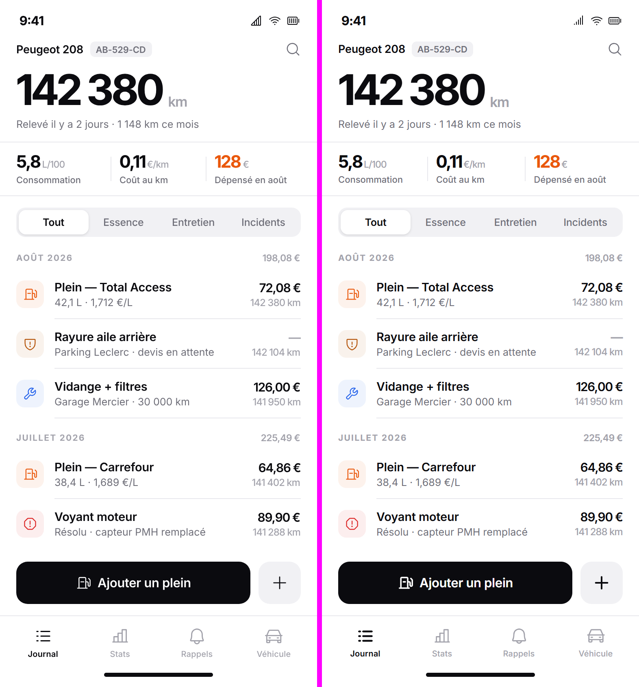

# Maquette

Éditeur de maquettes de sites, dans l'esprit de Figma, pensé pour travailler avec **Claude**.
On dessine à la main, ou on demande à Claude dans le chat intégré : il crée et modifie les calques
sous vos yeux, avec son propre curseur.



## Télécharger

Dernière version : **[Releases](https://github.com/joe-jns/maquette/releases/latest)**

| Système | Fichier |
| --- | --- |
| Windows | `Maquette-…-windows-setup.exe` |
| Mac Apple Silicon (M1, M2, M3…) | `Maquette-…-arm64.dmg` |
| Mac Intel | `Maquette-…-x64.dmg` |

**Sur Mac**, l'app n'est pas signée chez Apple : au premier lancement, faites un clic droit sur
Maquette, puis **Ouvrir**. Les lancements suivants se font normalement.

Le chat demande [Claude Code](https://claude.com/claude-code) installé et connecté (commande `claude`
dans le terminal). Il passe par votre abonnement Claude, pas par une clé d'API.

## Ce qu'on peut faire

- **Dessiner** : cadres, rectangles, ellipses, textes, images, vecteurs, icônes (Lucide, Phosphor,
  Feather, Material Symbols Rounded).
- **Mise en page automatique** : cadres en ligne ou en colonne, espacements, marges, tailles
  « contenu » ou « remplir », comme l'auto layout de Figma.
- **Styles** : remplissages (couleur, dégradés linéaire, radial et conique, image), contours, ombres,
  flous ; couleurs et styles de texte nommés.
- **Composants** : un cadre devient composant, ses instances suivent ses changements et gardent leurs
  modifications locales.
- **Claude dans l'app** : un chat qui lit la page, crée et retouche les calques, contrôle la qualité
  du design.
- **Claude Code de l'extérieur** : menu *File → Connect to Claude Code…* ; une session Claude Code
  peut alors lire et modifier le document ouvert (serveur MCP), même quand l'app est fermée.
- **Ouvrir des fichiers `.pen`** : ils sont convertis (le `.pen` n'est jamais modifié) avec un rapport
  de ce qui n'a pas pu être repris tel quel.
- **Fichiers** : enregistrement automatique, copie de secours en cas de plantage, accueil avec les
  fichiers récents et leurs aperçus, export PNG en 1×, 2× ou 3×.

La suite est dans la [feuille de route](docs/roadmap.md).

## Développer

Il faut Node.js 26 ou plus récent.

```bash
npm install
npm run dev        # l'app en mode développement
npm test           # tests unitaires (Vitest)
npm run e2e        # tests de l'app complète (Playwright)
npm run dist       # installateur Windows, dans dist/
npm run dist:mac   # .dmg pour Mac (sur un Mac seulement)
```

À chaque envoi sur `main`, GitHub construit la version Mac (onglet **Actions**).

Electron, React, TypeScript, zustand et immer. Le format `.maquette` est du JSON lisible.
